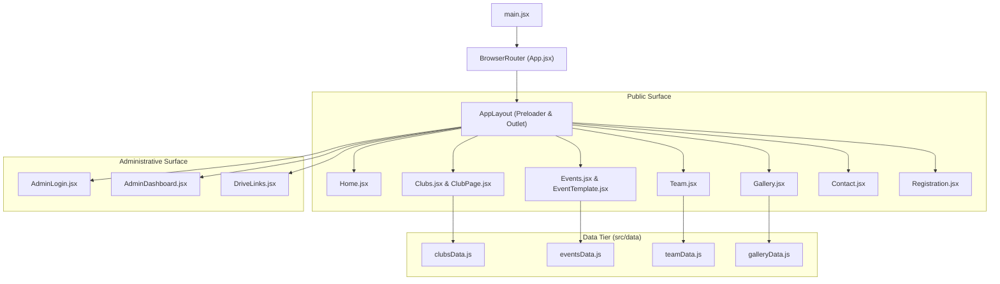

# Deep Architectural Analysis & Project Audit: Frontend

**Target:** `D:\CSC Codebases\Cultural_Sub_Council\frontend`  
**Stack:** React 19, Vite 8, Tailwind CSS 3, React Router DOM 7, Framer Motion 13  
**Audited At:** 2026-10-25

---

## 1. Project Architecture Overview

The frontend is a single-page application (SPA) built for the **Cultural Sub Council (CSC)** of Madan Mohan Malaviya University of Technology (MMMUT), Gorakhpur. It provides:
1. Public information portals for cultural clubs, flagship events (HEATS, Abhyudaya, Pintura), team directories, and media archives.
2. A multi-step registration engine for campus cultural competitions.
3. An administrative review portal with OTP-based authentication, candidate filtering, and link inspection.

---

## 2. Directory & Component Inventory

| Directory | Files | Primary Responsibility |
| :--- | :--- | :--- |
| `src/` | `main.jsx`, `App.jsx`, `index.css`, `Color` | Application entry, routing configuration, global CSS |
| `src/layouts/` | `AppLayout.jsx` | Full-screen video preloader management and layout outlet |
| `src/components/` | 11 components | Navigation, footer, text animations, image loaders, video players |
| `src/pages/` | 7 core pages | Home, Clubs, Events, Team, Gallery, Contact, Registration |
| `src/pages/clubs/` | `ClubPage.jsx` | Dynamic club template rendered with static data props |
| `src/pages/events/`| `EventTemplate.jsx` | Dynamic event template rendered with static data props |
| `src/pages/admin/` | 3 admin views | OTP login, candidate dashboard, Drive link verification panel |
| `src/data/` | 4 data files + `notes` | Static content stores for clubs, events, roster, and gallery |
| `public/` & `gallery/`| Static assets | Video preloader, logos, icons, unbundled video/photo media |

---

## 3. Detailed Component & Page Analysis

### 3.1 Public Surface
- **Home (`Home.jsx`):**
  - Features `HeroSlider` with 5 Cloudinary slides and typewriter effect.
  - Composes `LineTextReveal` (university bio), `FacultyMessages` (leadership quotes), and `ScrollStory` (pin-scroll competition achievements).
  - *Observation:* The page has inconsistent background coloring, transitioning abruptly from `#0E0504` to `#DCD3A4` across sections.
- **Clubs (`Clubs.jsx` & `ClubPage.jsx`):**
  - Displays Dance, Dramatics, Music, Fine Arts, and Technical clubs.
  - *Observation:* `Clubs.jsx` hardcodes club descriptions that duplicate `clubsData.js`. In `ClubPage.jsx`, `<Navbar Gallery />` passes an unrecognized boolean prop to `Navbar`.
- **Events (`Events.jsx` & `EventTemplate.jsx`):**
  - High-impact vertical stacking slider with sticky full-height cards for HEATS, Pintura, and Abhyudaya.
  - *Observation:* Casing mismatch in routes (`/events/Pintura` vs `/events/pintura`).
- **Registration (`Registration.jsx`):**
  - High-capability 3-step registration wizard handling solo, duo, and team enrollments, dynamic member rosters (up to 20 members), and Google Drive links for submissions.
  - *Observation:* Enforces strict `2026` admission cohort regex for roll numbers.
- **Contact (`Contact.jsx`):**
  - Form UI renders cleanly, but `handleSubmit` does not submit anywhere.

### 3.2 Admin Surface
- **Authentication (`AdminLogin.jsx`):**
  - Implements passwordless email OTP request and verification (`/api/admin/auth/request-otp`, `/verify-otp`) using HTTP-only cookies (`credentials: "include"`).
- **Candidate Dashboard (`AdminDashboard.jsx`):**
  - Comprehensive management panel: search by name/roll, filter by club and review status, modal profile viewer, and status decision patching (`approve` / `reject`).
- **Drive Review Panel (`DriveLinks.jsx`):**
  - Consolidates Google Drive links for dance tracks, photography photos, and fine art artwork.
  - *Observation:* Candidate pagination is omitted (locked to first 100), and review status is kept in client `localStorage` rather than synced with backend.

---

## 4. Key Metrics & Findings Summary

| Area | Current State | Target Recommendation |
| :--- | :--- | :--- |
| **Dependencies** | Includes unused Three.js and Fiber (80MB+) | Remove `three`, `@react-three/*`, `@bible-strong/*` |
| **Dead Code** | 5 files (`GalleryVideo.jsx`, `TypingText.jsx`, etc.) | Delete or refactor unused components |
| **Media Assets** | ~35.5 MB unused media in `gallery/` and `public/` | Remove `gallery/videos/video-01.mp4`, add to `.gitignore` |
| **Routing** | Static routes, missing 404, unguard admin | Implement dynamic `:id` routes, 404 handler, `ProtectedRoute` |
| **Theming** | 4 conflicting color schemes | Centralize colors into `tailwind.config.js` design tokens |
| **Contact Form**| Submissions dropped silently | Wire to backend `/api/contact` or email service |
| **Preloader** | Replays every time user clicks "Home" | Guard with `sessionStorage` or play-once state |

---

## 5. Prioritized Action Plan

1. **Phase 1: Critical Stability & Functionality**
   - Connect or properly communicate status for `Contact.jsx` submissions.
   - Broaden `isValidRollNumber` regex in `Registration.jsx` to support multi-year cohorts.
   - Add `<Route path="*" element={<NotFound />} />` in `App.jsx`.
   - Wrap `/admin/*` in an auth guard component (`ProtectedRoute.jsx`).

2. **Phase 2: Codebase Hygiene & Performance Optimization**
   - Uninstall unused dependencies: `npm uninstall three @react-three/fiber @react-three/drei @bible-strong/avatar-react`.
   - Delete obsolete components: `GalleryVideo.jsx`, `TypingText.jsx`, `ScrollTextReveal.jsx`, `src/Color`, `src/data/notes`.
   - Relocate or purge the unreferenced 32.7 MB `frontend/gallery/videos/video-01.mp4`.
   - Update `AppLayout.jsx` preloader to run once per session using `sessionStorage`.

3. **Phase 3: Design System Harmonization**
   - Consolidate theme colors in `tailwind.config.js` (`csc-maroon`, `csc-gold`, `csc-beige`, `csc-navy`).
   - Clean up arbitrary inline hex classes across `Home.jsx`, `LineTextReveal.jsx`, `FacultyMessages.jsx`, and `Navbar.jsx`.
   - Standardize `<Navbar />` positioning and active route states.
